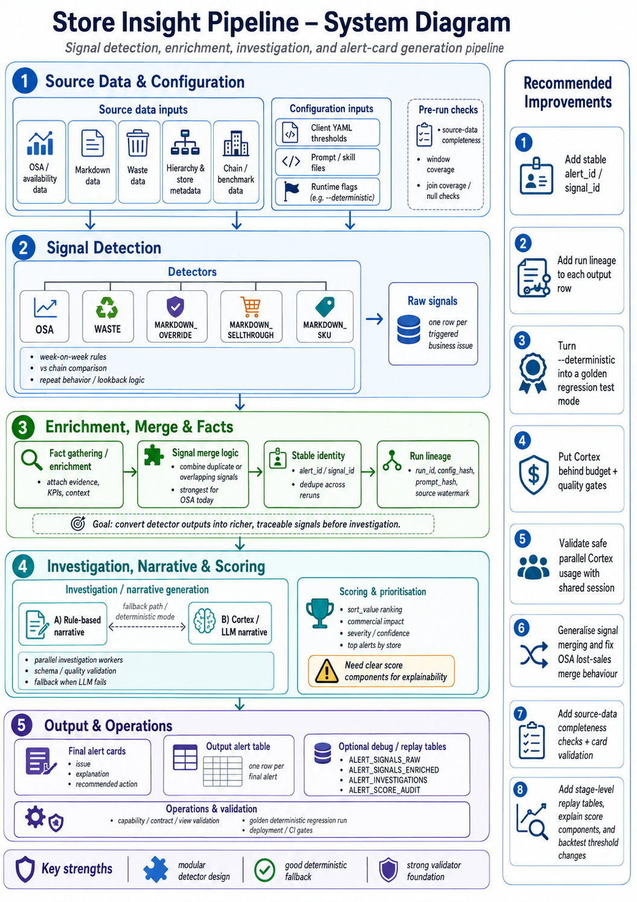

# Store Insight Pipeline — Practical Improvement Suggestions

## System diagram



The diagram summarizes the end-to-end flow: source data and configuration feed detector logic, raw signals are enriched and merged into traceable alert candidates, narratives are generated through rule-based or Cortex-backed investigation, and final alert cards are scored, validated, and written for downstream use. The right-hand panel highlights the recommended improvement areas from this review.

## 1. Give every alert a stable identity

One thing I would add quite early is a stable `alert_id` / `signal_id`.

At the moment the output card has the important business fields, but it would be much easier to track alerts over time if each alert had a deterministic ID based on the actual business issue.

For example:

```text
hash(client, analysis_date, signal_type, store_id, department, item_id)
```

This would help with:

- avoiding duplicate alerts on re-runs
- linking the same issue across weeks
- tracking whether an issue is new, continuing, worsening, or resolved
- joining pipeline output to user actions in the UI
- measuring whether the recommendation actually improved the KPI later

This feels especially useful because the pipeline already has strong alert-card output; stable identity would make it much easier to turn the cards into a closed-loop system.

---

## 2. Add run lineage to every output row

I would add a few lineage fields to the final alert table, not just the run date.

Useful fields:

```text
run_id
analysis_date
pipeline_version
config_hash
prompt_hash
skill_file_used
engine_used
fallback_used
source_data_watermark
```

This would make it much easier to explain why an alert changed between two runs.

For example, if the same store gets a different recommendation next week, we could tell whether it was due to:

- changed source data
- changed thresholds
- changed prompt/skill file
- Cortex behaving differently
- a code change

That would be very valuable from an MLOps and production-support point of view.

---

## 3. Turn `--deterministic` into a proper regression test mode

The existing `--deterministic` flag is a really good idea because it forces rule-based narratives and avoids LLM variability.

I would build on that and create a small “golden run” test suite.

For a fixed sample window, we could automatically check:

```text
number of raw signals
number of enriched signals
number of final cards
top alerts by store
trigger combinations
sort_value distribution
required card fields
```

This would catch accidental changes in detector logic, scoring, merging, or output shape before deployment.

It would also make migration work safer, especially if the pipeline later moves from Snowflake to Databricks.

---

## 4. Put Cortex behind a budget and quality gate

The Cortex/rule-based split is strong, but I would make the Cortex path more production-controlled.

The pipeline already supports parallel investigation workers, which is useful, but it also means Cortex usage can grow quickly if there are many alerts.

I would add:

```text
max_cortex_calls_per_run
max_tokens_per_run
retry/backoff policy
fallback reason
raw_llm_response
validated_json flag
card_quality_status
```

If the budget is exceeded, the pipeline could automatically fall back to rule-based narratives for the remaining cards.

This would protect cost, avoid noisy failures, and make Cortex behaviour easier to audit.

---

## 5. Check whether parallel Cortex calls are safe with the shared Snowpark session

In `run_pipeline_from_signals`, investigations can run in parallel using `ThreadPoolExecutor`, while the same Snowpark session is passed through to Cortex.

That is worth validating carefully.

If Snowpark sessions are not fully safe under concurrent Cortex calls, we could see intermittent failures that are hard to reproduce.

A practical improvement would be to either:

- use a bounded Cortex call queue
- create session-safe worker handling
- or run Cortex calls sequentially unless explicitly enabled

This is a small area, but it could prevent difficult production issues later.

---

## 6. Generalise signal merging beyond OSA

The merge logic is strongest for OSA alerts, but other signal types also have multiple detectors that can fire for the same business entity.

Examples:

```text
MARKDOWN_OVERRIDE: VS_CHAIN + WOW
WASTE: VS_CHAIN + WOW
MARKDOWN_SELLTHROUGH: VS_CHAIN + WOW
MARKDOWN_SKU: REPEAT_REQUEST + EXCESSIVE_OVERRIDE
```

I would make merge rules signal-type specific, so fields from both triggers are preserved.

For example, markdown override alerts should keep both the week-on-week fields and the chain-comparison fields:

```text
last_week_override_rate
wow_change_pp
chain_override_rate
above_chain_pp
this_week_total_markdowns
this_week_overrides
```

This would make multi-trigger cards richer and avoid losing useful evidence.

---

## 7. Fix the OSA lost-sales merge behaviour

There is already a test documenting that `this_week_lsv` currently ends up as “last non-null wins”, even though the docstring says it should take the maximum across merged signals.

That is a useful catch.

I would either:

- intentionally change the merge logic so `this_week_lsv` really takes the max, or
- rename/document the behaviour if “latest detector wins” is the desired rule

Given `sort_value` depends heavily on lost sales value, this is worth tightening.

---

## 8. Add source-data completeness checks before detection

The pipeline uses week-on-week changes, chain comparison, repeat behaviour, and lookback windows. These are all sensitive to incomplete data.

Before running detectors, I would add checks such as:

```text
Is this week's OSA data complete?
Is last week's comparison window complete?
Do all expected stores have data?
Did hierarchy joins drop too many rows?
Are lost sales and waste values non-negative?
Are WMD tables loaded up to the expected date?
```

If a source is late or incomplete, the pipeline should either fail safely or mark the affected cards as low confidence.

This would reduce false alerts caused by data freshness issues rather than real store performance issues.

---

## 9. Promote the existing validators into CI/CD gates

The project already has some strong validation pieces, especially:

```text
capability validation
contract validation
view validation
unit tests for detectors / facts / scoring
```

I would wire these into deployment so a release cannot go out unless the checks pass.

Suggested gates:

```text
ruff
pytest
validate_views for the target client
capability validation for enabled detectors/gatherers
deterministic golden-run comparison
```

This is not a big redesign; it is more about turning the existing good pieces into a release safety net.

---

## 10. Add stage-level debug tables for replay

The code already has `save_signals()` and `load_signals()`, which is a good foundation.

I would extend that idea into optional stage outputs:

```text
ALERT_SIGNALS_RAW
ALERT_SIGNALS_ENRICHED
ALERT_INVESTIGATIONS
ALERT_SCORE_AUDIT
```

That would make it much easier to replay only part of the pipeline.

For example:

- replay investigation after changing a prompt
- replay scoring after changing ranking logic
- replay facts without re-running detection
- compare Cortex output against rule-based output for the same signals

This would save time and reduce Snowflake/Cortex cost during development.

---

## 11. Add card-level validation before writing

Because the final output is shown to business users, I would validate the card before it reaches the output table.

The validator could catch:

```text
missing issue/explanation/action
empty or generic recommendations
None / nan leaking into text
invalid JSON
very long card text
missing facts for a trigger
Cortex output not matching the expected schema
```

This could be especially useful when Cortex is enabled, because it gives a final guardrail before the UI sees the card.

---

## 12. Make score components explainable

The current `sort_value` is useful, but I would also store the components behind it.

For example:

```text
commercial_impact_score
severity_score
trigger_weight
confidence_score
final_sort_value
score_reason
```

This would make it easier to explain to users why one card is ranked above another.

It would also help tune the system later without losing trust in the prioritisation.

---

## 13. Add threshold backtesting before changing YAML values

The thresholds are already nicely externalised in YAML, so the next useful step would be to test their impact before changing them.

For example, before adjusting values like `min_lost_sales_value`, `min_chain_gap`, or markdown/waste thresholds, we could run a small backtest that shows:

```text
How many alerts would be created?
Which stores would be added or removed?
Which alert types would increase?
Would the top 10 priority cards change?
Would any low-value/noisy alerts appear?
```

This would make threshold tuning more evidence-led and help avoid alert fatigue. It would also give the business a clearer view of the trade-off between catching more issues and creating too many cards for stores.

A simple output table or report comparing current vs proposed thresholds would be enough to start.

---

## 14. Add lifecycle and post-action measurement

The pipeline creates good action cards, but the next product-level improvement is to measure what happens after the card is created.

Useful statuses could be:

```text
generated
seen
assigned
worked
closed
reopened
resolved
ignored
```

Then we can measure impact:

```text
Did OSA improve after the alert?
Did waste reduce?
Did markdown behaviour improve?
Did the same issue come back next week?
```

This would make the system more than an alert generator. It would become a feedback loop for store performance.

---

## 15. Clean up package/import setup for easier automation

When running the tests directly from the extracted project, the import path expects the package to resolve as `store_insight`.

For local development and CI, it would be more robust to make the package installable in a standard way, for example:

```text
pip install -e .
```

or a clearer package layout.

This is a small MLOps/onboarding improvement, but it would make automated testing and deployment less fragile.

---

## Suggested priority order

If I had to prioritise, I would start with:

1. Add stable `alert_id` / `signal_id`.
2. Add run lineage: config hash, prompt hash, model/engine, source watermark.
3. Add source-data completeness checks.
4. Turn `--deterministic` into a golden regression test.
5. Fix/generalise signal merging, including the OSA LSV behaviour.
6. Promote validators into CI/CD gates.
7. Add Cortex budget, fallback, and quality metadata.
8. Validate shared-session safety for parallel Cortex calls.
9. Add threshold backtesting before changing YAML values.
10. Add stage-level replay/debug tables.
11. Add card validation and score explanations.